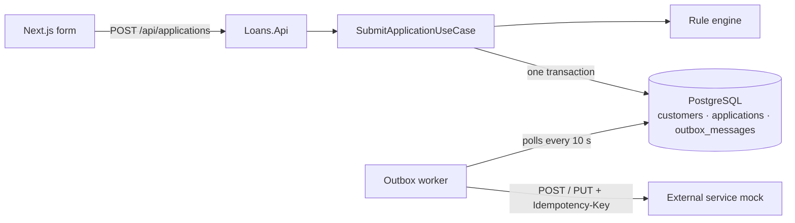

# Architecture

How the solution is built and why. Run instructions and test data are in the [README](README.md).



## Project structure

Clean Architecture: dependencies point inwards, and the inner layers know nothing about EF Core, HTTP or Postgres.

| Project | Responsibility |
| --- | --- |
| `Loans.Domain` | `Customer` aggregate (owns its one `LoanApplication`) and value objects `Ssn`, `Address`, `PersonalDetails`, which validate on creation. No dependencies. |
| `Loans.Application` | `SubmitApplicationUseCase`, the rule engine, the integration event, and the ports it needs (`ICustomerRepository`, `IUnitOfWork`, `ISsnBlacklist`, `IOutbox`). |
| `Loans.Infrastructure` | Adapters for those ports: EF Core + Npgsql, migrations, blacklist lookup, outbox writer and worker, HTTP client. |
| `Loans.Api` | Composition root and one thin endpoint: validate the request, call the use case, map the result to a status code. |
| `ExternalService.Mock` | Stand-in for the third party: in-memory, with optional failure injection. |

The use case depends only on interfaces it owns, so it is unit tested with fakes, and the database or HTTP client can be replaced without touching business code.

**Request outcomes:** approved and denied both return `200`, because a denial is a valid business answer, not an error. Invalid input returns `400` with errors per field. Two *first* submissions with the same SSN at the same moment return `409` (see below).

**Returning customer:** the use case looks the customer up by SSN. If found, `Customer.Resubmit` updates the same customer and application and the event is `ApplicationUpdated`; otherwise `Customer.Register` creates them and the event is `ApplicationCreated`. Rules run *before* this lookup, on every submission, so a denied returning customer changes nothing.

## Rule engine

`RuleEngine` receives every registered `IDenyRule` from dependency injection, runs them all, and returns a `Decision`: approved when no rule denies, otherwise the list of reason codes (`STATE_NOT_ALLOWED`, `SSN_BLACKLISTED`).

- One class per rule (Strategy pattern). The engine knows no rule by name, so adding a rule changes neither the engine nor the other rules (open/closed).
- All rules are evaluated, even after a denial, so the user sees every reason at once.
- The interface is async because the blacklist rule queries the database.
- The API returns codes; the frontend maps them to text.

**Adding a rule**, for example a maximum amount:

```csharp
// Loans.Application/Rules/DenyRules/MaximumAmountRule.cs
public sealed class MaximumAmountRule : IDenyRule
{
    public const string Code = "AMOUNT_TOO_HIGH";

    public Task<RuleResult> EvaluateAsync(LoanApplicationInput input, CancellationToken cancellationToken) =>
        Task.FromResult(input.RequestedAmount > 5_000_000m ? RuleResult.Deny(Code) : RuleResult.Pass(Code));
}
```

Then register it in `Loans.Application/DependencyInjection.cs` with `services.AddScoped<IDenyRule, MaximumAmountRule>();`, add tests in `Loans.UnitTests/Application/Rules/DenyRules/`, and optionally a message in `frontend/lib/reasonMessages.ts` (unknown codes fall back to a generic message).

## Transactions and the outbox

A database transaction cannot include an HTTP call. Saving first and then calling can lose the event; calling first and then saving can announce an application that was never stored.

So "publishing" means inserting a row into `outbox_messages` **in the same transaction** as the customer and application (transactional outbox):

- `LoansDbContext` is the unit of work. The repository and `OutboxWriter` only *add* to it and never save.
- The use case calls `SaveChangesAsync` **once**, so EF Core writes the customer, the application and the outbox row in one database transaction. The same applies to updates for a returning customer.
- The row holds a JSON snapshot of the payload, built before saving (IDs are UUIDv7s generated in code).

**What happens when something fails:**

| Failure | Result |
| --- | --- |
| Database down, or any error inside `SaveChangesAsync` (including the outbox insert) | Everything rolls back: no customer, no application, no event. The API returns `500` and the user can submit again. A test forces the outbox insert to fail in Postgres and checks this. |
| Two first submissions with the same SSN at once | The second hits the unique index on SSN and rolls back; the API returns `409`, and resubmitting takes the returning-customer path. |
| External service down, slow or returning `5xx` | The user is not affected; the worker retries (below). |
| API crash after the external service accepted a message, before it was marked done | The message is sent again after restart; the idempotency key makes that harmless. |

## Background event and external service

`OutboxBackgroundService`, a `BackgroundService` hosted by the API, checks the outbox every **10 s** (slow on purpose, so delivery is visible in the demo) and sends every due message, outside any HTTP request.

- **Order:** the next message is the oldest `Pending` one whose customer has no earlier message that is not yet `Processed`. A customer's PUT therefore never overtakes its POST, and one customer's failure does not block anyone else.
- **Mapping:** `ApplicationCreated` → `POST /applications`; `ApplicationUpdated` → `PUT /applications/{applicationId}`. Both carry `Idempotency-Key: <message id>` and time out after 10 s. The contract is described in the README.
- **Retries:** `5xx`, `408`, `429`, timeouts and network errors are retried after 2, 4, 8 and 16 s, then the message is marked `Failed` after 5 attempts. Other `4xx` responses are marked `Failed` at once, because retrying will not fix them. Attempts and the last error are stored on the row.
- **Delivery is at-least-once.** The mock ignores a repeated idempotency key, and a POST for an ID it already has creates nothing.

## Trade-offs

| Choice | Why | Cost / next step |
| --- | --- | --- |
| Polling only, no "send right after commit" | One delivery path to reason about and test | Up to 10 s of delay; Postgres `LISTEN/NOTIFY` would make it near-instant |
| Single API instance for the worker | Enough for this scope | Several instances need `SELECT ... FOR UPDATE SKIP LOCKED`, or a separate worker service |
| A `Failed` message holds back that customer's later messages | Keeps updates in order | Needs manual replay (set it back to `Pending`); next would be a replay endpoint and an alert |
| Short retry schedule (under a minute in total) | Visible in a demo | Real outages last longer: minutes to hours, with jitter |
| Migrations run on API startup | `docker compose up` needs no extra step | Production would run them as a deployment step |
| SSN stored in plain text | Simple equality lookup for the unique index | Encrypt at rest, plus a keyed hash for lookups. Only the last 4 digits leave the system; logs show a masked SSN. |
| Returning-customer updates are last write wins | Concurrent updates for one SSN are rare | Optimistic concurrency with `xmin` |
| Rule results are logged, not stored | Enough audit for this scope | A `rule_evaluations` table if decisions must be reported on |
