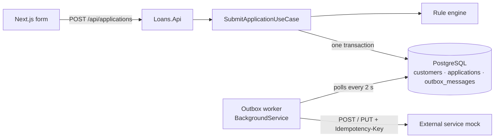
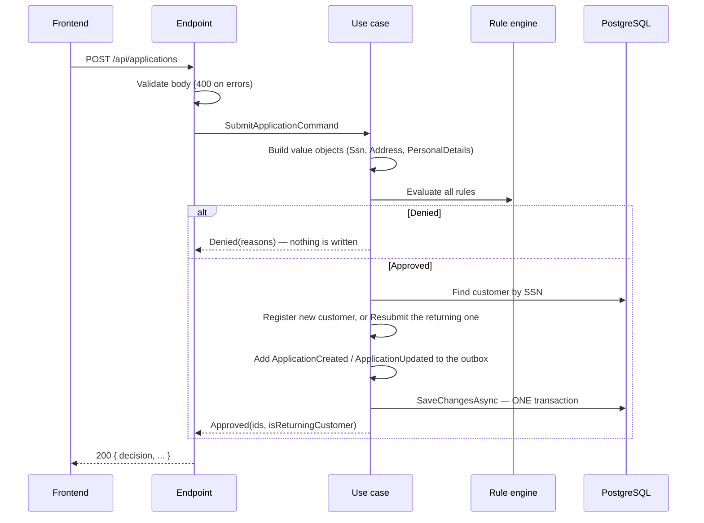

# Architecture

This document explains how the loan application flow is built, why it is built that way, and what was traded off. Run instructions are in the [README](README.md).

## Contents

1. [Overview](#1-overview)
2. [Project structure](#2-project-structure)
3. [Submitting an application, step by step](#3-submitting-an-application-step-by-step)
4. [Domain model](#4-domain-model)
5. [Rule engine](#5-rule-engine)
6. [Transaction and the outbox](#6-transaction-and-the-outbox)
7. [Background event delivery](#7-background-event-delivery)
8. [Failure handling](#8-failure-handling)
9. [Tests](#9-tests)
10. [Trade-offs and what I would do next](#10-trade-offs-and-what-i-would-do-next)

## 1. Overview



- The **frontend** validates the form and posts it to the API. It shows the Approved or Denied page from the response.
- The **API** runs the rules. If the application is approved, it saves the customer, the application **and** an outbox message in one database transaction, then answers right away.
- A **background worker** in the same process reads the outbox and delivers each message to the external service. That happens outside the HTTP request, with retries.

## 2. Project structure

The backend follows Clean Architecture: dependencies point inwards, and the inner layers know nothing about EF Core, HTTP or Postgres.

```
Loans.Api  ──►  Loans.Application  ──►  Loans.Domain
    │                 ▲
    └──►  Loans.Infrastructure ─┘   (implements the Application's interfaces)
```

| Project | Responsibility | Key folders |
| --- | --- | --- |
| `Loans.Domain` | Business objects and their invariants. No dependencies. | `Customers/` (aggregate), `Customers/ValueObjects/`, `Common/` (`Entity`, `DomainException`) |
| `Loans.Application` | The use case, the rule engine, the event contract, and the **ports** (interfaces) the use case needs. | `UseCases/SubmitApplication/`, `Rules/`, `Rules/DenyRules/`, `Events/`, `Abstractions/` |
| `Loans.Infrastructure` | Adapters: EF Core + Npgsql, migrations, the blacklist lookup, the outbox writer, worker and HTTP client. | `Persistence/`, `Blacklist/`, `Outbox/`, `ExternalService/` |
| `Loans.Api` | Composition root and the HTTP endpoint: request validation, mapping, status codes. | `Endpoints/`, `Contracts/`, `ErrorHandling/` |
| `ExternalService.Mock` | Stand-in for the third party. In-memory, with optional failure injection. | |

**Why ports in Application** (`ICustomerRepository`, `IUnitOfWork`, `ISsnBlacklist`, `IOutbox`): the use case is written against interfaces it owns. Infrastructure implements them (dependency inversion), so the use case is unit tested with in-memory fakes, and EF Core could be swapped without touching business code.

**Why the events live in Application, not Domain:** `ApplicationCreated` / `ApplicationUpdated` are *integration* events, a contract with an external system. Whether a submission is "created" or "updated" is decided by the use case, and the payload shape (for example, sharing only the last 4 SSN digits) is an integration concern, not a business rule.

## 3. Submitting an application, step by step



| Outcome | Status | Body |
| --- | --- | --- |
| Approved | `200` | `{ "decision": "approved", "applicationId", "customerId", "isReturningCustomer" }` |
| Denied | `200` | `{ "decision": "denied", "reasons": ["STATE_NOT_ALLOWED", "SSN_BLACKLISTED"] }` |
| Invalid input | `400` | ProblemDetails with `errors` per field (`FirstName`, `Address.State`, ...) |
| Concurrent first submission with the same SSN | `409` | ProblemDetails, "please submit again" |
| Unexpected failure (for example, the database is down) | `500` | ProblemDetails; nothing was saved |

A denial is a `200`: the request was valid and the business answer is "no". Error statuses are kept for requests the API could not process.

**Rules run before the returning-customer lookup.** Every submission is judged on what it says now. A returning customer who now applies from NY is denied, and their saved data and application stay exactly as they were. Nothing is written for a denied submission.

## 4. Domain model

- **`Customer` is the aggregate root.** One customer per SSN (unique index). Each customer owns exactly one `LoanApplication` (unique index on `customer_id`). Code outside the aggregate cannot create or change a `LoanApplication` directly: its factory and `ChangeAmount` are `internal`. Changes go through `Customer.Register` (new applicant) or `Customer.Resubmit` (returning applicant).
- **Value objects** validate on creation, so an invalid one cannot exist:
  - `Ssn`: accepts `123-45-6789` or `123456789` and stores 9 digits. `ToString()` and `Masked` give `***-**-6789`, so a full SSN never ends up in a log by accident.
  - `Address`: state is two uppercase letters; ZIP is `12345` or `12345-6789`.
  - `PersonalDetails`: names, company and address.
- **Requested amount** must be greater than 0 with at most 2 decimals. `Resubmit` checks the amount before changing anything, so a failed resubmit leaves the customer untouched.
- **IDs** are UUIDv7, generated in code. The outbox payload can be built before saving, because the IDs already exist; UUIDv7s are also time-ordered, which keeps the indexes compact.
- **Timestamps:** every entity has `CreatedAt` and a nullable `UpdatedAt`. An EF Core interceptor (`AuditTimestampsInterceptor`) sets `CreatedAt` on insert and `UpdatedAt` only on update; the domain never sets them.

Database mapping: `PersonalDetails` and `Address` are EF Core **complex types**, stored as columns on `customers`; there are no extra tables or joins. `Ssn` uses a value converter to a `char(9)` column. Names are snake_case.

## 5. Rule engine

```
Rules/
  RuleEngine.cs            runs every IDenyRule, returns a Decision
  Decision.cs              approved when no rule denied; DenialCodes lists the reasons
  RuleResult.cs            Pass(code) / Deny(code)
  LoanApplicationInput.cs  what rules can look at: Ssn, State, RequestedAmount
  DenyRules/
    IDenyRule.cs
    NewYorkStateRule.cs    STATE_NOT_ALLOWED
    SsnBlacklistRule.cs    SSN_BLACKLISTED (looks up the blacklist table through ISsnBlacklist)
```

- **Strategy pattern + open/closed principle.** Each rule is its own class behind `IDenyRule`. The engine receives `IEnumerable<IDenyRule>` from dependency injection and knows no rule by name, so adding a rule changes no existing rule and not the engine.
- **All rules are evaluated**, even after a denial, so the user sees every reason at once and the log has the full picture. The test `NewYorkAndBlacklisted_ReturnsBothCodes` fails if the engine stops early.
- **Async interface.** The blacklist rule queries the database. Pure rules return `Task.FromResult`. Rules run one after another, not in parallel, because one EF `DbContext` cannot run parallel queries, and there are only two cheap rules.
- **Reason codes, not messages.** The API returns stable codes; the frontend maps them to text (`frontend/lib/reasonMessages.ts`).
- **Audit:** every rule result is logged with the masked SSN.

### Adding a rule

Example: deny requested amounts above $5,000,000.

1. Add the class in `backend/src/Loans.Application/Rules/DenyRules/`:

   ```csharp
   namespace Loans.Application.Rules.DenyRules;

   /// <summary>Denies requests above the maximum amount.</summary>
   public sealed class MaximumAmountRule : IDenyRule
   {
       public const string Code = "AMOUNT_TOO_HIGH";

       private const decimal Maximum = 5_000_000m;

       public Task<RuleResult> EvaluateAsync(LoanApplicationInput input, CancellationToken cancellationToken) =>
           Task.FromResult(input.RequestedAmount > Maximum ? RuleResult.Deny(Code) : RuleResult.Pass(Code));
   }
   ```

2. Register it in `Loans.Application/DependencyInjection.cs`:

   ```csharp
   services.AddScoped<IDenyRule, MaximumAmountRule>();
   ```

3. Add unit tests next to the existing ones in `backend/tests/Loans.UnitTests/Application/Rules/DenyRules/`.
4. Add a user-facing message for the code in `frontend/lib/reasonMessages.ts`. Unknown codes fall back to a generic message, so this step is optional for the API to work.

If a rule needs data that `LoanApplicationInput` does not carry yet, add a property there. That is the only shared type that changes.

## 6. Transaction and the outbox

**Requirement:** saving the Customer + Application and publishing the event must happen in one transaction.

A database transaction cannot include an HTTP call to another system. If we called the external service directly, two things could go wrong:

- **Save, then call:** the commit succeeds, the call fails, and the external service never hears about the application.
- **Call, then save:** the call succeeds, the commit fails, and the external service knows about an application we do not have.

**Transactional outbox:** "publishing" means inserting a row into `outbox_messages` in the **same transaction** as the customer and application. Either all three rows are committed or none are. Delivery to the external service happens afterwards, from the outbox.

How the single transaction is guaranteed in code:

- `LoansDbContext` is the unit of work (`IUnitOfWork`). The repository and `OutboxWriter` only **add** entities to the context and never save.
- The use case calls `SaveChangesAsync` **once**. EF Core wraps all the inserts and updates of that call in one database transaction.
- The payload stored in the outbox is a JSON snapshot (`jsonb`) of the customer and application at commit time.

This is proved against real Postgres by `SubmitApplicationTransactionTests`. A test trigger makes Postgres reject the outbox insert, and the test checks that the customer and application inserts made in the same `SaveChangesAsync` are rolled back. Splitting the save into two calls makes that test fail.

## 7. Background event delivery

`OutboxBackgroundService` (a .NET `BackgroundService` hosted by the API) wakes up every **2 seconds** and delivers every due message. Each message gets its own DI scope and `DbContext`.

**Which message is next** (`OutboxProcessor`): the oldest message that is `Pending`, whose `NextAttemptAt` has passed, and whose customer has **no earlier message that is not yet `Processed`**. This gives:

- **Order per customer:** a customer's `ApplicationUpdated` (PUT) is never sent before its `ApplicationCreated` (POST) has landed. Otherwise the PUT would get a `404`.
- **Isolation between customers:** one customer's failing message does not hold up anybody else.

**Mapping to the external service** (`ExternalServiceClient`):

| Event | Request |
| --- | --- |
| `ApplicationCreated` | `POST /applications` |
| `ApplicationUpdated` | `PUT /applications/{applicationId}` |

Every request carries `Idempotency-Key: <outbox MessageId>`, and the HTTP client times out after 10 s.

**Retries** (`OutboxMessage.RecordFailure`):

| Response | Classification | What happens |
| --- | --- | --- |
| `2xx` | Success | `Processed`, `ProcessedAt` set |
| `5xx`, `408`, `429`, timeout, network error | Retryable | Retried after 2 s, 4 s, 8 s, 16 s (exponential); `Failed` after 5 attempts (about 30 s) |
| Other `4xx` | Permanent | `Failed` at once; retrying would not fix it |

`Attempts`, `LastError` and `NextAttemptAt` are stored on the row, so the state of every message can be inspected in the database.

**Delivery is at-least-once.** If the API crashes after the external service accepted a message but before the row is marked `Processed`, the message is sent again after restart. The receiver deduplicates with the idempotency key, and a `POST` for an ID it already has is a no-op, so duplicates are harmless.

## 8. Failure handling

| What fails | Effect | How it is handled |
| --- | --- | --- |
| Invalid input | Nothing runs | `400` with per-field errors (minimal API validation, plus `DomainException` → `400`) |
| Malformed or empty JSON body | Nothing runs | `400` (`BadRequestExceptionHandler`) |
| Database down or any error inside `SaveChangesAsync` | The transaction rolls back: no customer, no application, no outbox row | `500` ProblemDetails; the user can submit again. Tested with a forced outbox failure. |
| Two **first** submissions with the same SSN at the same moment | The second hits the unique index on SSN and rolls back | Postgres `23505` → `PersistenceConflictException` → `409`, "please submit again"; the retry takes the returning-customer path |
| External service down, slow or returning `5xx` | The API is unaffected; the user already has their answer | The outbox retries with backoff; the message stays `Pending` until it succeeds or reaches 5 attempts |
| External service rejects the message (`4xx`) | Message `Failed` | Logged with the error; that customer's later messages wait until it is replayed (see trade-offs) |
| API crashes or restarts | Committed messages are in the database | The worker picks them up on startup; duplicates are absorbed by the idempotency key |
| Worker loop throws (for example, the database blips) | One tick is lost | Logged; the next tick 2 s later tries again |

## 9. Tests

| Project | What it covers | Infrastructure |
| --- | --- | --- |
| `Loans.UnitTests` (69) | Rule engine and each rule; value objects and the `Customer` aggregate; the use case (new, **returning**, denied, conflict) with fakes; event payload; outbox retry policy; HTTP client mapping and error classification | None; in-memory fakes |
| `Loans.IntegrationTests` (13) | The **endpoint** through the real API (`WebApplicationFactory`): approved, returning customer, denials, `400`s; the transaction rollback; a denied returning customer changing nothing; the outbox processor's order, per-customer blocking and failure handling | PostgreSQL 17 in a Testcontainers container; the external service replaced by an in-process fake |

The real database is used for integration tests, not the EF in-memory provider, because the behaviour under test is the database's: transactions, unique indexes, `jsonb`, and identity columns.

In integration tests the background worker is switched off (`Outbox:WorkerEnabled=false`) and the tests run the processor by hand, so there is no timing to wait for.

## 10. Trade-offs and what I would do next

| Decision | Why | Cost, and what I would do with more time |
| --- | --- | --- |
| Outbox **polling** every 2 s, no "send right after commit" | One delivery path, simple to reason about and test | Up to about 2 s of delay. Could add an in-process signal after commit, or Postgres `LISTEN/NOTIFY`. |
| **Single API instance** assumed for the worker | Enough for this scope | Two instances could send the same message twice (still safe because of the idempotency key, but wasteful). Scale-out: `SELECT ... FOR UPDATE SKIP LOCKED`, or move the worker into its own service. |
| A **`Failed` message blocks that customer's later messages** | Keeps PUT from arriving before its POST | Needs a manual replay (reset the row to `Pending`). Next: an admin endpoint or a dashboard for failed messages, plus an alert. |
| Retries are **2/4/8/16 s, 5 attempts** (about 30 s) | Short enough to show in a demo | Real third-party outages last longer; production would use minutes to hours, with jitter. Note: the decision log listed 2–32 s, but 5 attempts leave room for only 4 waits; a 32 s wait would need a 6th attempt. |
| **Migrations run on API startup** | `docker compose up` works with no manual step | Risky with several instances or for destructive migrations. Production: a separate migration step in the deployment pipeline. |
| Rule results are **logged**, not stored | Enough for an audit trail in a demo | A `rule_evaluations` table would make decisions queryable and reportable. |
| The denied page tells the user **"SSN blacklisted"** | The challenge asks to show the reasons | A real product would likely show a generic message for fraud-related denials. |
| **SSN stored in plain text** (unique index needs equality) | Simplicity | Production: encrypt at rest, plus a keyed hash (HMAC) column for the unique lookup. The external payload already carries only the last 4 digits, and logs only carry the masked SSN. |
| Returning-customer updates use **last write wins** | Same SSN submitted twice at the same moment is rare | Add an optimistic concurrency token (`xmin`) and return `409` on conflict. |
| Payload stored as **`jsonb`** | Queryable when debugging | Postgres normalises the text (key order, spacing), so the bytes sent are not exactly the bytes written; the JSON content is the same. Use `json` or `text` if exact bytes ever matter. |
| One `LoanApplication` per customer | The challenge says to update the existing application | If history matters, keep past applications and mark one as current. |
| No authentication or rate limiting | Out of scope | Required before this went anywhere near real SSNs. |
